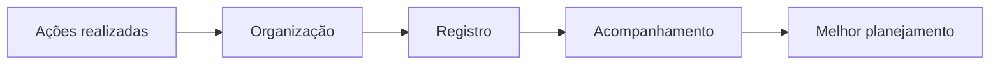

# SISPE

**Sistema de Apoio ao Planejamento e ao Acompanhamento de Ações de Saúde Mental no Programa Saúde na Escola**

*Tecnologia como apoio à promoção da saúde mental nas escolas.*

Projeto acadêmico · Análise e Desenvolvimento de Sistemas · UniCesumar · 2026

---

## Sumário

- [Sobre o projeto](#sobre-o-projeto)
- [Objetivo](#objetivo)
- [O problema](#o-problema)
- [Princípios do projeto](#princípios-do-projeto)
- [Tecnologias](#tecnologias)
- [Status](#status)
- [Contexto acadêmico](#contexto-acadêmico)
- [Equipe](#equipe)

---

## Sobre o projeto

O **SISPE** é uma proposta de sistema para **planejar, registrar e acompanhar ações coletivas de promoção da saúde mental** realizadas no ambiente escolar, no âmbito do **Programa Saúde na Escola (PSE)**.

A proposta é deixar essas ações mais organizadas, visíveis e fáceis de acompanhar, apoiando **gestores escolares** e **profissionais de saúde** no planejamento de novas atividades.

## Objetivo

Organizar as informações sobre as ações de saúde mental realizadas nas escolas, facilitando o acompanhamento e o planejamento.

O sistema deve oferecer uma **visão geral das ações realizadas**, ajudando a identificar:

- quais temas já foram trabalhados;
- quais temas ainda precisam de atenção.

## O problema

As ações de saúde mental nas escolas muitas vezes acontecem de forma **pontual e desarticulada**, o que dificulta saber o que já foi feito e planejar os próximos passos.

O SISPE propõe um fluxo contínuo:

## Princípios do projeto

| Privacidade | Foco coletivo | Apoio profissional |
| :---: | :---: | :---: |
| Sem dados individuais de estudantes | Ações e informações agregadas | Não substitui profissionais |

### Fora do escopo

O SISPE **não** tem como objetivo:

- armazenar dados individuais de estudantes;
- realizar diagnósticos;
- realizar triagens clínicas;
- prescrever tratamentos;
- fornecer recomendações automáticas.

> [!NOTE]
> Todos os dados usados no projeto são **fictícios e agregados**.

## Tecnologias

| Tecnologia | Uso |
| --- | --- |
|  | Linguagem de desenvolvimento do sistema |
|  | Controle de versão |
|  | Hospedagem do repositório e acompanhamento do desenvolvimento |

## Status

**Em desenvolvimento, na etapa de planejamento.**

| Etapa | Situação |
| --- | --- |
| Proposta e planejamento | Em andamento |
| Implementação do sistema | Próximas etapas |

Esta versão do repositório corresponde à **primeira etapa** do projeto e reúne a proposta e o planejamento do SISPE. A implementação será feita nas próximas etapas.

## Contexto acadêmico

| | |
| --- | --- |
| **Instituição** | Universidade Cesumar (UniCesumar) |
| **Curso** | Análise e Desenvolvimento de Sistemas |
| **Atividade** | Atividade Extensionista de Prática (AEP) |
| **Local** | Maringá, PR |
| **Ano** | 2026 |

## Equipe

| Integrante |
| --- |
| Lyvia Vitoria dos Santos Silva |
| Gabriel Detomini Rabelo |

---

**SISPE** · Tecnologia como apoio à promoção da saúde mental nas escolas.

